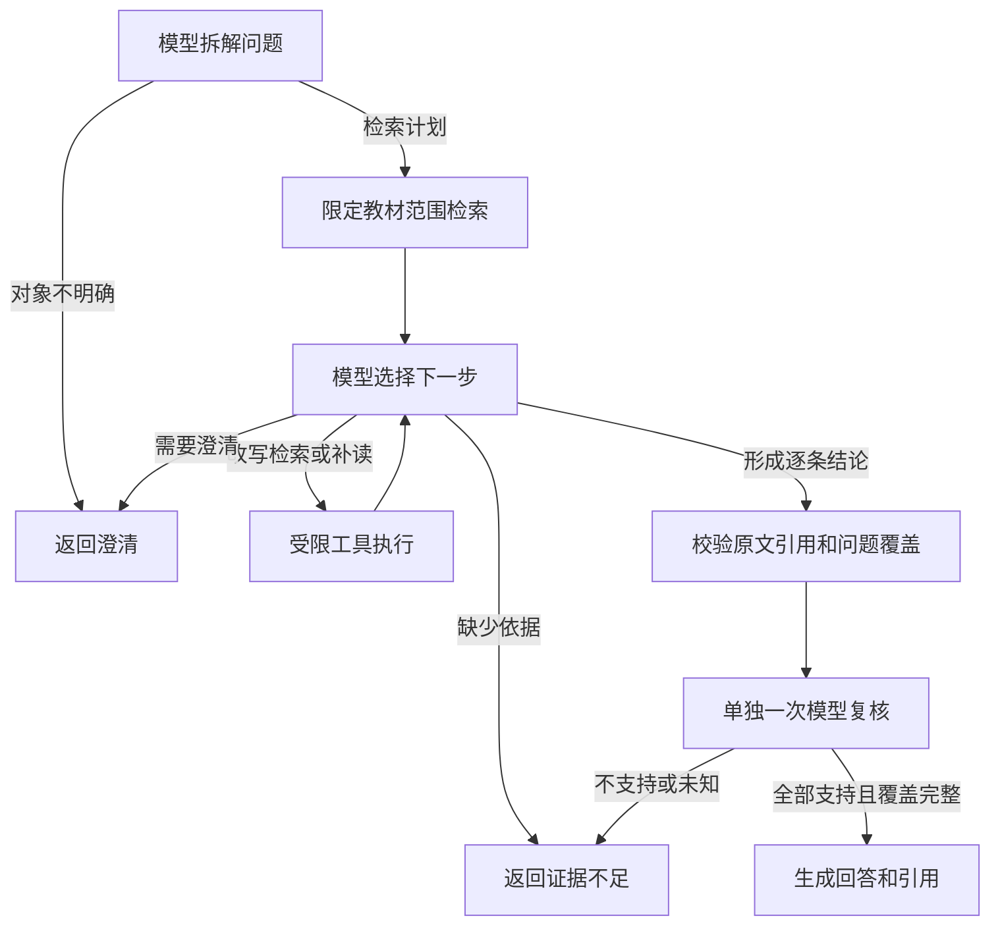

# Python 教材问答 Agent 原型

这是独立可运行的 Python 服务，使用 FastAPI、asyncio 和结构化模型输出组织教材问答。它能执行问题拆解、检索改写、补读相邻片段、逐条引用检查及最终模型复核。默认演示模式无需数据库、Java 或模型密钥。

**当前状态：已接入 Java 教材问答，搜索与澄清修复后的6题真实回归通过。** 原网页、会话历史、引用和重试入口直接复用；默认普通启动仍走Java基线。[首轮8题对照](../backend/evaluation/stage5-agent-results.md)的查询不匹配和过早澄清已修复，[6题新版复测](../backend/evaluation/stage5-agent-fix-results.md)全部通过，另外2题及独立新题仍待验证，阶段五整体未验收。独立 `demo` 模式继续提供固定场景演示，Java 会拒绝将演示服务用于用户教材问答。

## 在现有网页启用

已有可运行的 Java／Vue 环境、Python 3.11+ 和以下依赖时，停止原后端，然后运行：

```powershell
cd D:\AI-Tutor\backend
.\run-with-agent.cmd
```

若依赖安装在本项目虚拟环境，使用 `.\run-with-agent.cmd -Python D:\AI-Tutor\agent-service\.venv\Scripts\python.exe`。前端仍按项目原方式启动，在资料库选教材后进入主聊天提问。此路径只接管普通教材问答，不接管普通教师聊天或“依据教材学习”的备课流程。

[启动器](../backend/run-with-agent.ps1) 读取 `backend/.env`，进程环境优先；复用 `DEEPSEEK_*` 配置，显式 `AGENT_MODEL_*` 优先。它生成或复用两端共享的服务令牌，在环回地址8091启动单worker Python服务，再调用原 `run.cmd` 启动Java。端口占用时拒绝覆盖正在运行的服务。停止启动器会清理它创建的Python进程并恢复环境；日志保存在 `backend/target/agent-run-*/`。启动本身不发生成请求，用户提问后每次最多4次模型调用。

也可分别启动两端：Java设置 `PYTHON_AGENT_ENABLED=true`、`PYTHON_AGENT_BASE_URL`、`AGENT_SERVICE_TOKEN`、`AGENT_JAVA_SERVICE_TOKEN`；Python设置 `AGENT_MODE=live`、`AGENT_ENABLE_REAL_MODEL=true`、模型配置、对应两枚令牌及 `AGENT_JAVA_BASE_URL`。Java等待默认55秒，禁止重定向和自动应用层重试，使用HTTP/1.1对接Uvicorn。恢复原入口可使用默认 `PYTHON_AGENT_ENABLED=false` 启动；已有请求保留首次保存的执行方式，不在重试时静默切换。

## 运行方式

需要 Python 3.11 或以上。首次安装可以在此目录创建虚拟环境；已有满足 `pyproject.toml` 的环境可直接运行：

```powershell
cd D:\AI-Tutor\agent-service
python -m venv .venv
.\.venv\Scripts\python.exe -m pip install -e ".[test]"
```

以下命令使用虚拟环境解释器；使用已有环境时将 `.\.venv\Scripts\python.exe` 换成 `python`。

最简演示：

```powershell
.\.venv\Scripts\python.exe -m tutor_agent.demo --scenario rewrite
```

可选场景：`answer`（回答）、`rewrite`（改写重检）、`read`（补读）、`refuse`（证据不足）、`clarify`（澄清）。这些场景调用真实状态机，但模型决策和教材均为固定夹具；不连接外部模型，不能用于评价语义能力。

启动独立 HTTP 服务：

```powershell
$env:AGENT_MODE = 'demo'
$env:AGENT_SERVICE_TOKEN = [guid]::NewGuid().ToString('N')
.\.venv\Scripts\python.exe -m uvicorn tutor_agent.app:build_app --factory --host 127.0.0.1 --port 8091 --workers 1
```

服务令牌至少为 24 个无空白 ASCII 字符。以上随机令牌只存在于启动终端的环境中，客户端需使用同一个值；可在服务启动前从该终端打开继承环境的客户端终端。不要把实际令牌写入仓库或日志。用 `Ctrl+C` 停止服务。

`.env.example` 只列出配置项，直接启动Python程序**不会自动读取 `.env`**。默认 `demo`；启用 `live` 需要同时设置 `AGENT_ENABLE_REAL_MODEL=true`、模型密钥和 Java 服务凭据。一键启动器负责从Java配置映射这些变量；真实模式提问会产生模型调用，脚本演示不产生外部调用。

## 执行流程



模型只能选择检索、补读、形成草稿、澄清或拒答；执行器不接受任意函数名、SQL、命令或网络地址。历史用户问题仅用于理解追问，不能当作教材证据。教材内容和用户输入在提示中标为数据。

v2规划要求明确命名的陌生概念先检索、唯一历史对象继续沿用，多义才澄清；搜索接受完整问题、空格关键词和分号分隔多问，Java分别排序并轮流取最多4段。候选可包含只有对象上下文而缺所问属性的原文，必须在后续决定补查或拒答。决策输入含`previous_queries`和`allowed_actions`，不能通过重复查询绕过预算；跨段指代的主张需同时引用对象上下文和事实段。

每个结论必须覆盖计划中的子问题，并附有已返回片段中的逐字原文。执行器检查片段归属、版本、同位置一致性及引用字面匹配，最后一次模型调用判断原文是否支持结论和是否答全问题。该判断来自同一个模型，可能存在共同错误；所有结果固定返回 `semantic_acceptance: "not_evaluated"`，不会把结构检查通过当作语义验收。

默认预算由服务端代码控制，调用方不能在请求中提高：

| 限制 | 默认值 |
| --- | --- |
| 模型调用 | 最多 4 次，失败和超时也计数；预留 1 次最终复核 |
| 检索 / 补读 | 最多 2 次检索、1 次补读；完整成功路径在模型预算内最多增加一次工具动作 |
| 子问题 / 草稿结论 | 最多 4 个 / 8 条 |
| 截止时间 | 总计 45 秒；单次模型 15 秒，工具 5 秒 |
| 单次模型输出 | 最多 2048 tokens |
| 证据上下文 | 最多 16 个不同片段、合计 20000 字符 |
| 最终引用 | 最多 8 个不同片段，与现有Java历史契约一致 |
| HTTP 请求体 / 上游响应 | 最多 64 KiB / 256 KiB |
| 同时执行 / 进程内登记容量 | 2 个 / 128 个 |

规范化后重复的检索会停止。补读只能使用已检索片段作为锚点，邻片须属于同一文档和修订版本，位置在锚点前后各一片以内。预算不足、未知证据、版本变化或超时均停止，不发布未复核草稿，不自动重试或切换模型。可空`stop_reason`区分`repeated_query`、`search_limit`、`read_limit`、`review_reserved`，Java对应显示具体原因。6题真实回归含4个事实回答、1次拒答和1次澄清，中位2.982秒；小样本不能替代负载性能验证。

## Python HTTP 接口

`GET /health` 无需认证，返回运行模式、`production_ready: false`，以及live模式下的 `java_integration: "available"` 或演示模式的 `"demo_only"`；available表示适配器可用，不证明Java连通或真实模型质量。其他路径（包括 OpenAPI 文档）均要求 `Authorization: Bearer <AGENT_SERVICE_TOKEN>`。服务用于 Java 内部调用，不接受浏览器用户 JWT 作为服务凭据。

`POST /v1/runs` 接受以下演示请求。`scope_token` 在接入模式下由 Java 签发；此处固定值仅用于演示夹具，不代表真实用户授权。

```json
{
  "version": "1",
  "request_id": "demo-request-1",
  "attempt": 1,
  "user_id": 7,
  "conversation_id": 10,
  "document_ids": [11],
  "scope_version": "demo-v1",
  "scope_token": "local-demo",
  "question": "函数局部变化快慢叫什么？",
  "recent_user_questions": []
}
```

在持有同一服务令牌的客户端终端发送请求：

```powershell
$agentBody = @{
    version = '1'; request_id = 'demo-request-1'; attempt = 1
    user_id = 7; conversation_id = 10; document_ids = @(11)
    scope_version = 'demo-v1'; scope_token = 'local-demo'
    question = '函数局部变化快慢叫什么？'; recent_user_questions = @()
} | ConvertTo-Json
Invoke-RestMethod -Method Post -Uri 'http://127.0.0.1:8091/v1/runs' -Headers @{Authorization = 'Bearer ' + $env:AGENT_SERVICE_TOKEN} -ContentType 'application/json; charset=utf-8' -Body ([System.Text.Encoding]::UTF8.GetBytes($agentBody))
```

问题最长 2000 字符；历史最多 10 条用户问题；教材 ID 最多 20 个且不得重复；`attempt` 为 1–100。请求禁止额外字段。Java在新Agent请求预占前检查问题长度，将自己的已授权ID和最近用户问题映射到此契约，历史每条最多2000字符；完整原历史仍由Java保存。Java同一问题最多允许两次Agent执行，每次预占4次调用，因此不会使用Python契约的全部100次上限。

结果直接返回 JSON，不套用 Java 的 `{code,message,data}`。业务处理结果为 HTTP 200，调用方必须读取 `status`：

| status | 含义 |
| --- | --- |
| `answered` | 返回 `answer`、逐条 `claims` 和所用 `sources`，通过本轮结构及模型复核 |
| `clarification` | `message` 是需要用户补充的信息；没有回答或引用 |
| `insufficient` | 无法用已有材料完整支持回答，含复核不支持或未知 |
| `budget_exhausted` | 调用、检索、补读或证据容量达到上限 |
| `timeout` | 单步或总截止时间到达 |
| `upstream_error` | 模型或 Java 工具不可用／响应契约异常 |
| `invalid_output` | 模型内容不符合结构契约 |
| `invalid_evidence` | 引用、范围、覆盖或片段快照无法核对 |

结果还包含 `model_calls`、`searches`、`reads`、token 用量、`usage_complete` 和只含操作／结果／耗时的 `trace`。演示中的模型次数指脚本决策次数；外部模型调用始终为零。缺失用量或调用失败时 `usage_complete=false`，不能把已知用量合计当作实际账单。

HTTP 401 表示认证失败，409 表示相同执行标识对应不同内容，413 表示请求过大，422 表示请求字段无效，503 表示并发或登记容量已满。

## Java 工具回调契约

Spring Boot 已实现以下两个内部端点，通过独立服务凭据和本次请求的范围凭据保护：

| 端点 | 额外请求字段 |
| --- | --- |
| `POST /internal/agent/v1/search` | `query`、`limit: 4` |
| `POST /internal/agent/v1/read` | `anchor_ids`、`radius: 1`、`limit: 8` |

二者均携带 `request_id`、`attempt`、`user_id`、`conversation_id`、`document_ids`、`scope_version`。认证头为 `Authorization: Bearer <AGENT_JAVA_SERVICE_TOKEN>`，范围凭据在 `X-Tutor-Scope` 中。`AGENT_JAVA_BASE_URL` 默认 `http://127.0.0.1:8080`，适配器将其与上表完整路径拼接；与现有公开 `/api` 接口不同。

Java验证服务身份及HMAC范围凭据，再锁定会话、检查启用的用户、会话归属、所选教材、活动学习流程、当前尝试和教材可用性。范围记录绑定本次教材及SHA-256修订快照，签名关联用户、会话、请求标识、尝试、范围版本和60秒有效期。全文片段ID、位置及文本参与快照，因此同文重处理也使原范围失效。每次工具调用重新校验，检索次数、规范化查询和允许补读的片段ID同步保存。成功响应结构如下：

```json
{
  "code": 200,
  "data": {
    "request_id": "demo-request-1",
    "attempt": 1,
    "scope_version": "demo-v1",
    "chunks": [
      {
        "id": "chunk-11-0",
        "document_id": 11,
        "chunk_index": 0,
        "revision": "revision-1",
        "text": "此处为教材片段原文。"
      }
    ]
  }
}
```

`chunks` 最多 8 项，每项文本最多 4000 字符。HTTP 非 200、HTTP 200 但业务 `code` 非 200、重定向或非法响应都停止本次运行。密钥分别按目标请求发送，范围凭据不会进入模型提示。仅环回地址允许 HTTP，远程上游要求 HTTPS；不自动使用环境代理。

真实模型适配器读取 `AGENT_MODEL_BASE_URL`、`AGENT_MODEL_NAME` 和 `AGENT_MODEL_API_KEY`，向固定 `/chat/completions` 发送非流式 JSON 请求，关闭思考输出。默认配置见 [.env.example](.env.example)。2026-10-31修复轮经计数转发层执行16次真实DeepSeek请求，覆盖plan／decide／review、补读与最终回答；逐题内容审阅6/6通过，质量结论限于所测案例。

## 一致性与后续接入

Python 不连接数据库，不写会话或学习记录。Java负责登录、所有权、完整会话历史、事务和最终业务写入。新教材问题按配置选择唯一执行路径，保存 `engine: python-v1` 后重试沿用这一选择；旧请求缺少该字段时继续原Java路径。本服务提示仅负责教材问答，不复制教师／备课流程。

进程内按 `(user_id, request_id, attempt)` 登记完整请求指纹；相同请求共享正在执行的任务或已保存结果，失败也不会自动重跑。不同内容返回 409。容量满后拒绝新增执行，不自动淘汰去重记录。单个 HTTP 等待者断开不取消共享运行，总截止时间仍生效；服务关闭会取消活动任务。

Python登记**不持久化且不跨进程共享**，运行时仍使用 `--workers 1`。Java已复用原 `rag_request_id / rag_attempt / rag_status / rag_context` 协议：先在短事务内登记processing并预占4次模型调用额度，提交后只分派一次；失败保存为failed，重复同一次不重新分派。原问题最多预占8次，用户显式重试消耗第二组4次，跳号及第三次尝试拒绝；额度是保守上限，未使用部分不退还。重启不会清除Java预占记录，处理中失联仍按原180秒恢复窗口等待用户下一次尝试，不能保证供应商恰好执行一次。

最终提交在Java短事务内重新校验用户、会话、尝试和教材快照，锁定教材与片段，再核对每条引用是本次已返回的原文、结论引用顺序以及回答只包含复核后的结论。回答、引用、completed状态和汇总调用日志一起保存；超时、服务故障或非法结果没有未经核对的助手回答，不自动重试或回退到Java模型调用。拒答与澄清正常保存为空引用回答。

调用汇总保存在内部 `rag_context.agent.audit`，包含用量完整性及 `semantic_acceptance`；失败或连接中断时可能没有完整用量，只保留预占额度和失败状态，不能将调用日志里的0当作零费用。`ai_call_log` 用 `PythonAgent / python-agent-v1 / rag_agent_chat` 标识汇总记录，不代表供应商每次调用的独立日志。

当前接入试验还限制最多2000个教材片段、合计200万字符、单片4000字符；超限在模型调用前拒绝。Python进程登记满128项会拒绝新增执行；这是明确保留的试验容量限制，尚未实现长期缓存管理、多实例调度或全站费用配额。新版仅完成6题真实回归，完整8题、更长真实资料、上传分片、独立题集、负载时延与账单费用仍待评估。

## 文件与验证

| 文件 | 职责 |
| --- | --- |
| [runner.py](tutor_agent/runner.py) | 状态机、预算、截止时间及证据校验 |
| [contracts.py](tutor_agent/contracts.py) | 请求、动作、证据和结果契约 |
| [prompts.py](tutor_agent/prompts.py) | 拆解、决策和复核提示 |
| [adapters.py](tutor_agent/adapters.py) | 模型及 Java HTTP 适配器 |
| [app.py](tutor_agent/app.py) | FastAPI、服务认证及进程内去重 |
| [demo.py](tutor_agent/demo.py) | 无外部调用的演示夹具 |

在此目录运行：

```powershell
.\.venv\Scripts\python.exe -m pytest -q
$agentSmokeOutput = Join-Path '..\backend\target' ('python-agent-smoke-' + [guid]::NewGuid().ToString('N'))
.\.venv\Scripts\python.exe scripts/smoke.py --output-dir $agentSmokeOutput
.\.venv\Scripts\python.exe -m pip wheel --no-deps --no-build-isolation --no-cache-dir . --wheel-dir ..\backend\target\python-agent-dist
```

HTTP 脚本要求新输出目录，会启动临时环回服务、验证后停止，并保存 `result.json` 和服务日志。2026-10-30 验证：48 项自动测试通过；17 项真实 HTTP 检查通过，覆盖五种演示场景、认证、重复请求和内容冲突；wheel 构建通过。最终 HTTP 记录位于 `backend/target/python-agent-http-smoke-final/`（构建目录不提交）。本次没有外部模型调用，未重跑 Java／前端构建或现有网页验收。

2026-10-31接入验证：后端308项测试及构建、Python50项测试、前端56项测试及构建、既有脚本105项测试通过。隔离MySQL、真实Java／Python进程和本地HTTP模型替身完成16组联调，其中网页包含4项操作检查及桌面／移动截图。记录位于 `backend/target/python-agent-integration-2/`；临时库和服务已清理，外部模型调用0次。JDK传输回归需Java17在PATH中，无JDK时该项跳过。

可复现完整接入验证（先构建后端，需要具有临时建库权限的本机MySQL账号及浏览器测试依赖）：

```powershell
cd D:\AI-Tutor
node backend/scripts/verify-python-agent.mjs --env-file backend/.env --output-dir backend/target/python-agent-new-run --mysql-bin "C:/Program Files/MySQL/MySQL Server 8.0/bin/mysql.exe" --java-bin "C:/Program Files/Eclipse Adoptium/jdk-17.0.20.8-hotspot/bin/java.exe" --python-bin python --browser
```

输出目录必须未存在，脚本仅向环回模型替身发送请求，独立建库并在结束时清理。不加 `--browser` 时跳过网页验证。该测试不依赖真实模型密钥。
